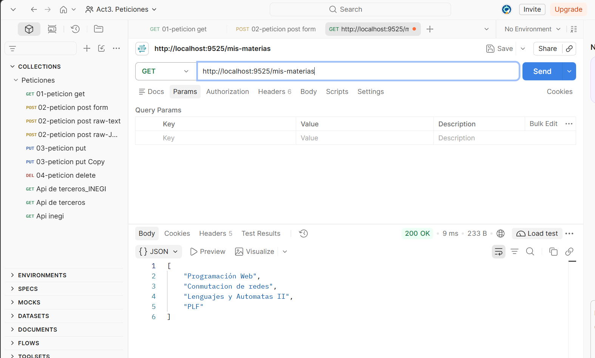
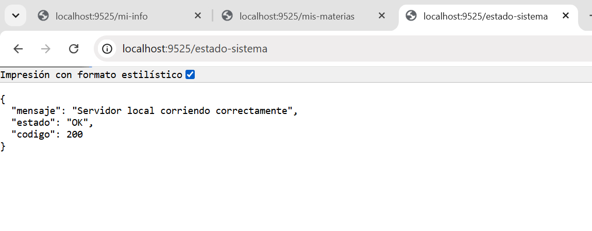
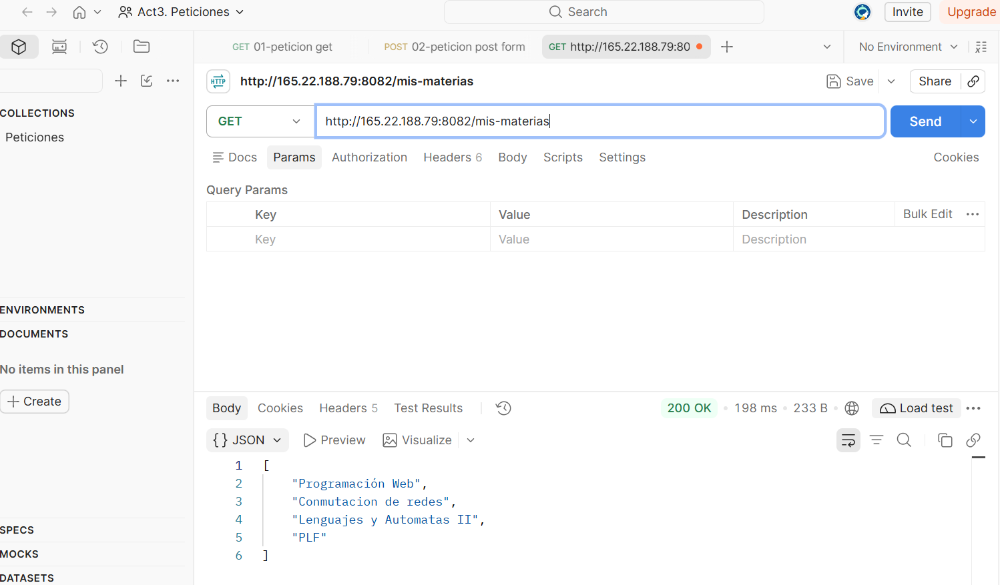
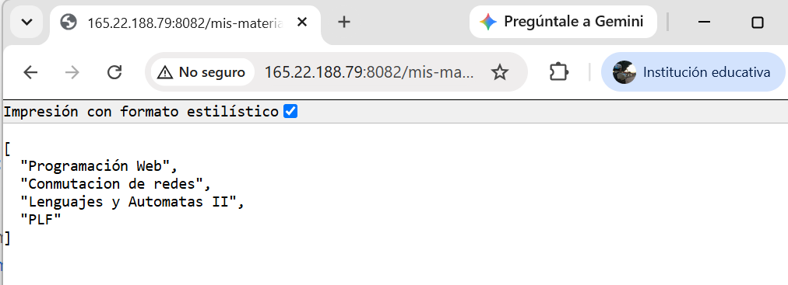

# Proyecto Spring Boot - Actividad 1 Tema 4

**Alumno / Iniciales:** DMIE  
**Repositorio:** DMIEact1_t4  
**Puerto en VPS:** 8082  
**Entorno de Java:** JDK 21

## Descripción del Proyecto
Aplicación Web desarrollada con Spring Boot y desplegada en un servidor compartido VPS. El proyecto incluye controladores REST encargados de exponer información del alumno, materias en curso y respuestas adicionales a peticiones HTTP GET.

## Controladores y Endpoints

### 1. `InfoController.java`
* **`GET /mi-info`**  -> Endpoint a) Retorna el nombre del proyecto / iniciales para identificar la instancia activa en el servidor.

### 2. `DatosController.java`
* **`GET /mis-materias`** -> Endpoint b) Retorna un arreglo JSON con el listado de materias en curso ("Programación Web", "Conmutacion de redes", "Lenguajes y Automatas II", "PLF").

### 3. `AdicionalController.java`
* **Endpoint c)** -> Retorna una respuesta adicional (texto, número o estructura de datos simple).

## Pruebas y Ejecución

### 1. En Máquina Local
1. Abrir la terminal en la raíz del proyecto en VS Code.
2. Compilar y ejecutar la aplicación:
   .\mvnw spring-boot:run
Mientras la app se ejecute en la PC, probar en Postman o navegador:
http://localhost:8082/mis-materias 

### 1. En el Servidor VPS

IP del VPS: 165.22.188.79
Puerto asignado: 8082
URL de verificación directa:
http://165.22.188.79:8082/mi-info
http://165.22.188.79:8082/mis-materias
http://165.22.188.79:8082/estado-sistema

